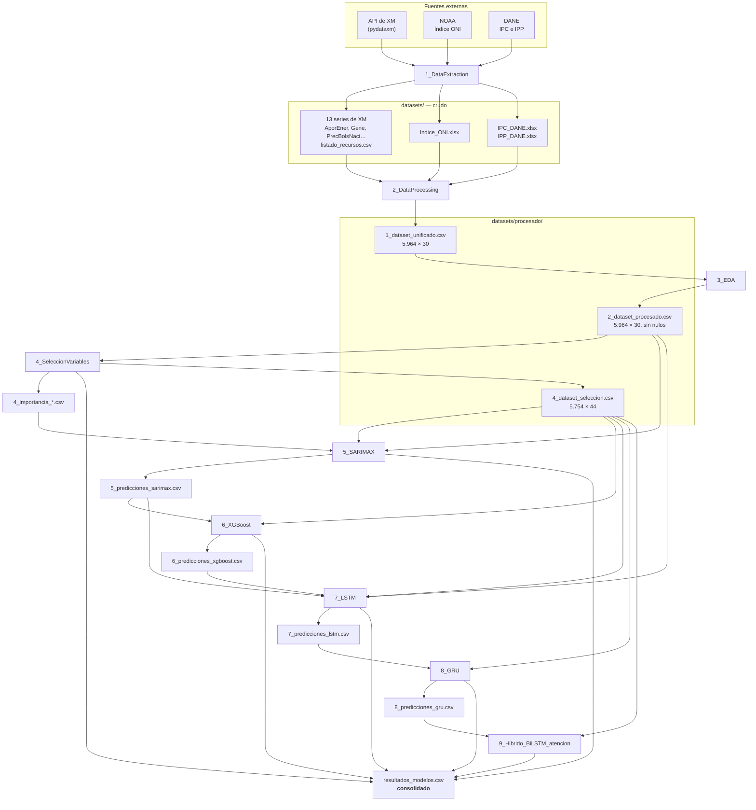

# Pipeline del trabajo: cómo se ejecuta y qué hace cada notebook

Trabajo Integrador — Maestría en Analítica e Inteligencia de Negocios, Universidad del Valle.
Pronóstico del **precio de bolsa de la energía eléctrica en Colombia a 30 días**, comparando
familias de modelos bajo condiciones idénticas.

Este documento describe el estado **real** del repositorio. El mapa de entradas y salidas se derivó
leyendo las llamadas de lectura y escritura del código de cada notebook; los tiempos, de los
metadatos de ejecución de la última corrida guardada; las cifras, de `resultados_modelos.csv`.

---

## 1. Cómo ejecutar

### 1.1 El entorno

Python **3.10.14**, en un entorno conda llamado `tesis_xm`. Si no existe:

```bash
conda env create -f requirements_py_3_10_14.yml
```

Las versiones que produjeron los resultados publicados: TensorFlow 2.15.0, XGBoost 3.2.0,
statsmodels 0.14.2. Las demás dependencias están en `requirements_py_3_10_14.txt`.

### 1.2 Desde Visual Studio Code, paso a paso

**1. Extensiones.** Hacen falta dos, de Microsoft: **Python** (`ms-python.python`) y **Jupyter**
(`ms-toolsai.jupyter`).

**2. Abrir la carpeta correcta.** `File → Open Folder…` y elegir **`Trabajo_Integrador_MAIN_PB`**,
la carpeta que contiene los notebooks. No una carpeta superior.

Esto no es una preferencia: **los nueve notebooks resuelven sus rutas contra el directorio de
trabajo**. Los notebooks 1 a 6 lo hacen con `pathlib.Path.cwd()` y los 7 a 9 con rutas relativas
(`os.path.join("datasets", "procesado")`), pero el requisito es el mismo. Si el directorio de
trabajo no es la raíz del repositorio, las lecturas fallan o —peor— los archivos se escriben en
otra parte.

**3. Elegir el kernel.** Con un notebook abierto, botón `Select Kernel` arriba a la derecha →
`Python Environments…` → **`tesis_xm`**. El kernel queda recordado por notebook.

**4. Comprobar el directorio de trabajo antes de nada.** Los notebooks 1 a 6 lo imprimen en su
primera celda:

```
Directorio de trabajo: C:\...\Trabajo_Integrador_MAIN_PB
```

Si esa línea termina en otra carpeta, hay que cerrar y reabrir VS Code sobre la carpeta correcta.
Los notebooks **7, 8 y 9 no imprimen esta línea**, de modo que ahí un error de ruta se manifiesta
más tarde y de forma menos clara: conviene abrir primero uno de los anteriores para confirmarlo.

Si VS Code se abrió sobre una carpeta superior, la alternativa es ajustar
`jupyter.notebookFileRoot` a `${fileDirname}` en la configuración del espacio de trabajo, que es
además el valor por omisión.

**5. Ejecutar.** `Run All` en la barra del notebook corre todas las celdas en orden. Antes de una
corrida completa conviene **reiniciar el kernel** (`Restart`), porque una variable sobreviviente de
una ejecución parcial anterior puede enmascarar un error.

### 1.3 Reglas que no se pueden saltar

| Regla | Por qué |
|---|---|
| **Correr el notebook entero, de arriba abajo** | Las celdas dependen del estado de las anteriores. Ejecutar solo la celda que interesa produce resultados que no se pueden reproducir |
| **Respetar el orden 1 → 2 → 3 → 4 → 5 → 6 → 7 → 8 → 9** | Cada uno consume lo que escribió el anterior. Las dependencias reales están en §6 |
| **Un notebook de aprendizaje profundo a la vez** | Los notebooks 7, 8 y 9 piden todos los núcleos disponibles a TensorFlow. Dos a la vez compiten y los tiempos dejan de ser comparables |
| **No ejecutar el notebook 1 sin motivo** | Rehace la extracción desde la API de XM y obliga a rehacer toda la cadena. Los datos del periodo de estudio ya están descargados |
| **Guardar el notebook después de correrlo** | Las salidas se guardan dentro del `.ipynb`. Un notebook sin salidas guardadas no documenta nada |

### 1.4 Ejecución desatendida

Para reejecutar un notebook sin abrirlo —útil cuando solo cambió una celda y hay que regenerar las
salidas— sirve `nbclient` con el mismo entorno:

```python
import nbformat
from nbclient import NotebookClient

nb = nbformat.read("3_EDA_Consolidado_actualizado.ipynb", as_version=4)
NotebookClient(nb, timeout=1800, kernel_name="python3",
               resources={"metadata": {"path": "."}}).execute()
nbformat.write(nb, "3_EDA_Consolidado_actualizado.ipynb")
```

El `resources={"metadata": {"path": "."}}` fija el directorio de trabajo, que es justo lo que §1.2
exige. Conviene respaldar antes el dataset que el notebook escribe y comparar su huella después: si
cambió, la cadena que viene detrás deja de ser válida.

---

## 2. El flujo, de un vistazo



---

## 3. Qué hace cada notebook

Los tiempos son de cómputo efectivo, derivados de los metadatos de la última corrida guardada.

### `1_DataExtraction.ipynb` — extracción

| | |
|---|---|
| **Lee** | API de XM (`pydataxm`, pública y sin credenciales); NOAA (`oni.ascii.txt`); DANE (anexos de IPC e IPP) |
| **Escribe** | `datasets/*.csv` (13 series de XM), `Indice_ONI.xlsx`, `IPC_DANE.xlsx`, `IPP_DANE.xlsx`, `listado_recursos.csv`, `metrics.csv` |
| **Módulo** | `_periods.py` — trocea el rango de fechas, porque la API limita los días por solicitud |

Funciona en **modo incremental**: descarga solo lo que falta y repite los últimos **90 días**,
porque XM ajusta las cifras recientes. `MODO = "completo"` rehace todo desde el inicio.

`metrics.csv` es el **catálogo de métricas de la API de XM** (`MetricId`, `MaxDays`, `Url`…), no el
registro de resultados de los modelos. Se sobrescribe en cada corrida.

### `2_DataProcessing.ipynb` — ETL · 55 s

| | |
|---|---|
| **Lee** | las 17 fuentes crudas de `datasets/` |
| **Escribe** | `datasets/procesado/1_dataset_unificado.csv` (5.964 × 30) y 17 series intermedias por variable |

Homogeneiza granularidades (horaria → diaria, mensual → diaria), construye el calendario colombiano
y fija el **periodo de estudio** en la constante `FECHA_FIN_ESTUDIO`. Las series intermedias
(`aportes.csv`, `precio_bolsa.csv`, …) son puntos de inspección: ningún notebook posterior las lee.

### `3_EDA_Consolidado_actualizado.ipynb` — exploración · 40 s

| | |
|---|---|
| **Lee** | `1_dataset_unificado.csv` |
| **Escribe** | `2_dataset_procesado.csv` (sin nulos), **21 figuras** en el propio notebook, y dos de ellas también como PNG: `3_clasificacion_enso.png` y `3_explicativas_comparadas.png` |

Diagnostica, no filtra. De aquí salen cuatro decisiones del trabajo: modelar el **logaritmo** del
precio, usar `d = 1`, incorporar un componente estacional **semanal** y no uno anual, y reportar el
error **segmentado por fase ENSO**. Las dos figuras que el documento reproduce se guardan desde
aquí, de modo que la del notebook y la del documento no pueden divergir.

### `4_SeleccionVariables.ipynb` — selección · 8,3 min

| | |
|---|---|
| **Lee** | `2_dataset_procesado.csv` |
| **Escribe** | `4_dataset_seleccion.csv` (5.754 × 44), `4_importancia_permutacion.csv`, `4_importancia_por_bloque.csv`, `4_importancia_shap.csv`, `4_importancia_shap_por_fase.csv`, `4_metricas_modelo_base.csv` |

Construye el problema supervisado —cada fila es un **origen** `t` y su objetivo es el **precio medio
de los 30 días siguientes**; `objetivo_dia30` guarda aparte el precio del día 30—, fija la partición
y mide importancia por permutación agrupada sobre cinco pliegues de validación progresiva.
Selecciona **5 variables de origen** y **38 columnas predictoras**. Registra además las dos
referencias ingenuas.

### `5_SARIMAX_modelo_base.ipynb` — familia estadística · 12,9 min

| | |
|---|---|
| **Lee** | `4_dataset_seleccion.csv`, `2_dataset_procesado.csv`, `4_importancia_permutacion.csv`, `4_importancia_por_bloque.csv`, `4_metricas_modelo_base.csv` |
| **Escribe** | `5_predicciones_sarimax.csv`, `5_metricas_sarimax.csv`, `5_error_por_horizonte.csv`, `models/baseline/SARIMAX/sarimax_base.pickle` |
| **Módulo** | `_resultados.py` |

`SARIMAX (2,1,1)(1,0,0,7)` sobre `log(precio)`, con calendario y variables del sistema como
regresores. MAE **170,49** sobre los pares origen-horizonte; **136,70** sobre el promedio del mes.
Es el único de los cinco que produce la trayectoria de 30 pasos sin un modelo por horizonte.

La matriz exógena se indexa por **fecha objetivo** y contiene variables del origen `t−30`, de modo
que el pronóstico del día `t+h` solo emplea información disponible en `t`: el modelo es ex ante,
igual que los otros cuatro.

### `6_XGBoost_modelo_base.ipynb` — machine learning clásico · 29,7 min

| | |
|---|---|
| **Lee** | `4_dataset_seleccion.csv`, `4_importancia_por_bloque.csv`, `4_metricas_modelo_base.csv`, `5_predicciones_sarimax.csv` |
| **Escribe** | `6_predicciones_xgboost.csv`, `6_metricas_xgboost.csv`, `6_importancia_xgboost.csv`, `6_error_por_horizonte_xgb.csv`, `models/baseline/XGBoost/xgboost_base.json` |
| **Módulo** | `_resultados.py` |

MAE **175,59** en pares, **143,17** sobre el promedio del mes. El objetivo se modela como el
**cambio logarítmico** respecto del precio del origen, porque un árbol no extrapola fuera del rango
visto. La trayectoria exige **un modelo por horizonte**: 30 × 5 semillas = 150 corridas.

### `7_LSTM_modelo_base.ipynb` — aprendizaje profundo · 16,2 min

| | |
|---|---|
| **Lee** | `4_dataset_seleccion.csv`, `2_dataset_procesado.csv`, `5_predicciones_sarimax.csv`, `6_predicciones_xgboost.csv` |
| **Escribe** | `7_predicciones_lstm.csv`, `7_metricas_lstm.csv`, `7_error_por_horizonte_lstm.csv`, `7_trayectoria_lstm.npy`, `models/baseline/LSTM/lstm_base.keras` |
| **Módulo** | `_resultados.py` |

MAE **176,93** en pares, **144,83** sobre el promedio del mes. Es el notebook que fija el montaje de
la familia, y el único que **no lee las 38 columnas**: recibe una **ventana de 31 días × 4
variables**, porque con las columnas ya agregadas la red tendría un solo paso temporal y una LSTM de
un paso se reduce a una capa densa. Antes de entrenar comprueba que la ventana contiene la misma
información —reconstruye desde ella 36 de las 38 columnas con error relativo máximo del orden de
10⁻¹⁰— y las dos que faltan entran como variables estáticas.

El error de validación tiene **forma de U** con el mínimo entre 3 y 15 épocas. Una rejilla que solo
hubiera examinado 30 y 60 épocas habría declarado inservible a una familia que sirve.

### `8_GRU_modelo_base.ipynb` — aprendizaje profundo · 34,6 min

| | |
|---|---|
| **Lee** | `4_dataset_seleccion.csv`, `2_dataset_procesado.csv`, `5_predicciones_sarimax.csv`, `6_predicciones_xgboost.csv`, `7_predicciones_lstm.csv` |
| **Escribe** | `8_predicciones_gru.csv`, `8_metricas_gru.csv`, `8_error_por_horizonte_gru.csv`, `8_trayectoria_gru.npy`, `models/baseline/GRU/gru_base.keras` |
| **Módulo** | `_resultados.py` |

MAE **163,17** en pares, **132,47** sobre el promedio del mes, **215,56** en el día 30: el mejor de
los cinco en las tres lecturas, y el único que supera a la persistencia en los treinta horizontes.

Va sobre el **mismo montaje del notebook 7** —la misma ventana, las mismas estáticas, el mismo
objetivo relativo, la misma rejilla y las mismas semillas— de manera que la única diferencia sea la
celda recurrente. Recalcula la dispersión entre semillas de la LSTM desde las columnas de aquel
notebook, con el mismo criterio que la suya, para que las dos sean comparables.

### `9_Hibrido_BiLSTM_atencion_modelo_base.ipynb` — familia híbrida · 31,9 min

| | |
|---|---|
| **Lee** | `4_dataset_seleccion.csv`, `2_dataset_procesado.csv`, las predicciones de los notebooks 5, 6, 7 y 8, y `resultados_modelos.csv` |
| **Escribe** | `9_predicciones_hibrido.csv`, `9_metricas_hibrido.csv`, `9_error_por_horizonte_hibrido.csv`, `9_trayectoria_hibrido.npy`, `9_diebold_mariano.csv`, `models/baseline/Hibrido/hibrido_base.keras` |
| **Módulo** | `_resultados.py` |

Descomposición de la ventana en tendencia, estacionalidad y residuo; BiLSTM sobre cada componente;
mecanismo de atención sobre la secuencia. MAE **172,30** en pares, **140,17** sobre el promedio del
mes: tercero de cinco, con **menos parámetros que la LSTM**. El modelo más complejo no es el mejor,
y no por tamaño sino por mecanismo.

Es además el cuaderno donde se cierra la comparación, porque es el último de la cadena y lee las
predicciones de los otros cuatro. Su sección 9 reúne las cinco configuraciones y la persistencia
sobre los mismos 1.155 orígenes, y su **celda 9.4** las somete a la prueba de **Diebold-Mariano**
en los quince pares posibles. La prueba se corrige por el solapamiento de las ventanas —varianza
de Bartlett con veintinueve rezagos y ajuste de Harvey, Leybourne y Newbold— porque dos orígenes
consecutivos comparten veintinueve de sus treinta días objetivo: sin esa corrección, ocho de los
quince pares parecerían significativos y con ella **ninguno lo es**. Ese resultado no cambia el
orden entre familias, que se mantiene en todas las lecturas; acota hasta dónde puede afirmarse.

### Los modelos guardados no son la configuración publicada

Los cinco archivos de `models/baseline/` se guardan con `SEMILLAS[0]` —la semilla 42— y
corresponden al **último reajuste**, no al conjunto de las cinco semillas que las tablas reportan.
Sirven para inspeccionar la arquitectura o los coeficientes; no para reproducir una cifra publicada.

### De dónde sale cada figura del documento

Hay dos clases, y conviene no confundirlas porque se reproducen de maneras distintas.

Las **figuras de análisis** son la salida ejecutada de una celda y viajan dentro del `.ipynb`: se
reproducen reejecutando su cuaderno. Las cinco que comparan familias —los cuatro pronósticos sobre
el periodo de prueba y la curva por horizonte— las dibuja **`_figuras.py`**, un módulo con una sola
definición de cada una, para que una corrección en un cuaderno no deje a los otros cuatro con una
figura distinta sin que nada avise.

Las **figuras conceptuales** —la metodología CRISP-DM, el recorrido de los datos, la extracción, la
partición y el embudo de la selección— no salen de ningún cuaderno: las dibujan los cinco scripts
de **`figuras_diagrama/`**, que tiene su propio README.

Qué imagen va bajo qué leyenda está en **`figuras_documento.md`**. La mayoría se resuelve sola,
comparando la imagen del documento con la de cada celda, pero unas pocas no: cuatro pronósticos y
cuatro curvas de aprendizaje que solo se distinguen en el modelo, y alguna figura que el cuaderno
dibuja **dos veces**, una ancha para mirarla en pantalla y otra al ancho de la página. Esas están
decididas a ojo y anotadas allí, con el porqué.

### La escala: un punto del dibujo es un punto del papel

Toda figura se dibuja a **1.289 píxeles de ancho y 186 puntos por pulgada**, que son las 6,93
pulgadas del ancho útil de la página, y con la letra al **cuerpo del documento, 10 puntos**. Las
tres piezas tienen que ir juntas:

- `a_escala(fig, cuerpo=10.0)` reparte el tamaño: el título un punto por encima del cuerpo, y los
  rótulos de eje, los números y la leyenda al cuerpo, sin descuento.
- El **recorte automático del backend está desactivado** en la celda de configuración de cada
  cuaderno. Con `bbox_inches="tight"` la imagen no sale al tamaño que se le dio sino ajustada a su
  contenido, de modo que al subir la letra la figura se *ensancha*; y una imagen más ancha metida
  en el mismo ancho de columna tiene más puntos por pulgada, luego su letra se ve más pequeña. Así
  se perdía la mitad de la subida.
- El documento tiene que **insertarla al ancho completo de la columna**. Insertada más estrecha,
  la letra se reduce en esa proporción por mucho que el dibujo esté bien.

Si una figura no cabe con esa letra, lo que sobra es texto de la figura —una glosa entre
paréntesis, un título que repite la leyenda de Word— o le falta alto; el tamaño no se baja.

---

## 4. El protocolo, idéntico para todas las familias

Esto es lo que permite que la comparación responda a la pregunta del trabajo y no a una diferencia
de montaje. Cualquier modelo nuevo lo hereda sin discutirlo.

| | |
|---|---|
| **Horizonte** | 30 días |
| **Entrenamiento** | 4.568 orígenes, 2010-06-30 a 2022-12-31 |
| **Embargo** | todo enero de 2023 (31 días), de ningún bloque |
| **Prueba** | 1.155 orígenes, 2023-02-01 a 2026-03-31 (20,1 %) |
| **Validación** | 5 pliegues progresivos dentro del entrenamiento, con purga de 30 días |
| **Semillas** | 42, 7, 123, 2024 y 99 en la configuración elegida |
| **Pronóstico** | los **30 días** de cada origen: 1.155 × 30 = 34.650 pares origen-horizonte |
| **Métricas** | MAE, RMSE y SMAPE, siempre en COP/kWh sobre el precio reconstruido |
| **Lecturas** | `pares_30d`, `promedio_30d` y `dia_30`, calculadas con `lecturas()` de `_resultados.py` |
| **Condición de utilidad** | una configuración solo se adopta si supera a la persistencia en los cinco pliegues |

Las fronteras se fijan **por fecha y alineadas a periodos completos**, no como fracción de filas:
varias variables son series mensuales propagadas a diario, y la evaluación por fase ENSO también se
define sobre meses.

**Las tres lecturas no son comparables entre sí.** Salen del mismo pronóstico y lo único que cambia
es qué se resume. Lo que importa es que el orden entre modelos coincida en las tres.

---

## 5. Los resultados

Configuración declarada de cada familia, sobre el bloque de prueba. MAE en COP/kWh.

| Familia | Modelo | `pares_30d` | `promedio_30d` | `dia_30` | SMAPE |
|---|---|---|---|---|---|
| Deep Learning | **GRU** | **163,17** | **132,47** | **215,56** | **26,75** |
| Estadística | SARIMAX | 170,49 | 136,70 | 219,52 | 28,66 |
| Híbrida | BiLSTM con atención y descomposición | 172,30 | 140,17 | 226,45 | 28,86 |
| Machine Learning | XGBoost | 175,59 | 143,17 | 232,74 | 30,40 |
| Deep Learning | LSTM | 176,93 | 144,83 | 233,48 | 31,09 |
| Referencia | Persistencia | 178,37 | 145,66 | 239,27 | 30,54 |
| Referencia | Media del entrenamiento | 300,84 | 292,57 | 298,97 | — |

El orden coincide en las tres lecturas. Tres precisiones que acompañan a esta tabla:

1. **La victoria del GRU es del conjunto de las cinco semillas**, no de una corrida: su desviación
   entre semillas es de 6,05 COP/kWh y dos de las cinco quedan por detrás del SARIMAX.
2. **Ningún modelo gana en todas partes.** El SARIMAX conserva el mejor reparto por regímenes: gana
   en El Niño y en 2024, que es donde se decide el error del periodo.
3. **El consolidado contiene además variantes exploratorias** con MAE menor que la configuración
   declarada de su propia familia. Ordenar `resultados_modelos.csv` por MAE y quedarse con la mejor
   fila de cada modelo produce un ranking falso: hay que filtrar por la configuración declarada.

---

## 6. Qué invalida qué

El orden es estricto: cada notebook consume lo que produjo el anterior.

```
1 → 2 → 3 → 4 → 5 → 6 → 7 → 8 → 9
```

| Si cambia… | Hay que rehacer |
|---|---|
| la extracción (1) | todo |
| el ETL o el periodo de estudio (2) | 3, 4 y los cinco modelos |
| el EDA (3) | 4 y los cinco modelos, porque escribe `2_dataset_procesado.csv` |
| la selección (4) | los cinco modelos: la comparación solo vale si todos ven las mismas variables |
| un notebook de modelo | solo él, y los posteriores que lo leen para comparar |

Los notebooks de modelos son **independientes entre sí** en cuanto al ajuste: cada uno entrena sobre
`4_dataset_seleccion.csv`. Leen las predicciones de los anteriores únicamente para comparar, y esa
comparación **no es decorativa**: el notebook se detiene si la persistencia o los modelos anteriores
no reproducen las cifras publicadas de sus propios notebooks, porque entonces la partición o el
embargo habrían cambiado y las tablas no serían comparables.

Los notebooks 2 a 9 son **reproducibles**: reejecutados, producen datasets idénticos. En los tres de
aprendizaje profundo eso no sale gratis —`set_random_seed` no basta, porque algunas operaciones de
CPU multihilo suman en orden variable— y por eso llaman además a `enable_op_determinism()`.

Reejecutar la cadena completa, del 2 al 9, cuesta algo más de **dos horas** de cómputo.

---

## 7. El consolidado de resultados

`_resultados.py` expone `registrar(...)`, que deja **una fila por corrida y por lectura** en
`resultados_modelos.csv` con las tres métricas, la configuración, la partición, el embargo, la
semilla y el bloque. Si una corrida repite exactamente la misma configuración, **reemplaza** la fila
en vez de acumular duplicados.

Tres piezas lo mantienen comparable, y cada una cierra un error que ya se cometió:

| Pieza | Qué impide |
|---|---|
| `objetivo`, obligatorio y sin valor por omisión | que se mezclen las tres lecturas en una misma tabla: sus MAE miden cosas distintas |
| `olvidar(notebook)`, antes del primer `registrar()` | que sobrevivan filas de corridas anteriores cuya configuración ya no existe. Cada notebook es **dueño** de sus filas |
| `lecturas(trayectoria, reales)`, compartida | que cada familia construya sus propios resúmenes y la comparación mida los resúmenes en vez de los modelos |

**Las referencias ingenuas aparecen repetidas a propósito.** Cada notebook de modelo recalcula la
persistencia sobre su propio conjunto de orígenes en vez de leerla de otro sitio. Que las filas
tengan el **mismo** MAE es la comprobación de que los notebooks construyeron la partición igual; si
difirieran, se vería aquí.

Al añadir un notebook de modelo nuevo hay que llamar a `olvidar()` **una sola vez**, antes de su
primer registro: dos llamadas borrarían lo que la primera acaba de escribir.

---

## 8. Dónde queda cada cosa

```
Trabajo_Integrador_MAIN_PB/
├── 1_DataExtraction.ipynb … 9_Hibrido_BiLSTM_atencion_modelo_base.ipynb
├── _periods.py              troceo de fechas para la API de XM        (notebook 1)
├── _resultados.py           registro único de métricas                (notebooks 4 a 9)
├── resultados_modelos.csv   consolidado: una fila por corrida y por lectura
├── metrics.csv              catálogo de la API de XM
├── README.md                la cara pública: qué es el trabajo y qué resultados hay
├── PIPELINE.md              este archivo: cómo se ejecuta y qué hace cada notebook
├── CONCEPTOS.md             guía conceptual: por qué se hace cada cosa, desde cero
├── datasets/
│   ├── *.csv, *.xlsx        crudo, tal como lo entregan XM, NOAA y DANE
│   └── procesado/           1_unificado → 2_procesado → 4_seleccion, y las salidas de modelos
└── models/baseline/
    ├── SARIMAX/sarimax_base.pickle      XGBoost/xgboost_base.json
    ├── LSTM/lstm_base.keras             GRU/gru_base.keras
    └── Hibrido/hibrido_base.keras
```

`datasets/` **sí se versiona**, salvo las tres series crudas que pasan del límite de 100 MB de GitHub
(`Gene.csv`, `DispoDeclarada.csv` y `PrecOferDesp.csv`), y `metrics.csv` también, porque el cuaderno 3
lo lee. `models/` no se versiona: ver arriba por qué esos cinco archivos no son la configuración
publicada. Lo que falta se regenera ejecutando la cadena; el README dice qué corre desde un clon.

---

## 9. Entorno

Python **3.10.14**. Dependencias en `requirements_py_3_10_14.txt` / `.yml`.
Principales: `pydataxm`, `pandas`, `numpy`, `statsmodels`, `scikit-learn`, `xgboost`, `shap`,
`tensorflow`, `matplotlib`, `seaborn`, `nbformat`, `nbclient`.
